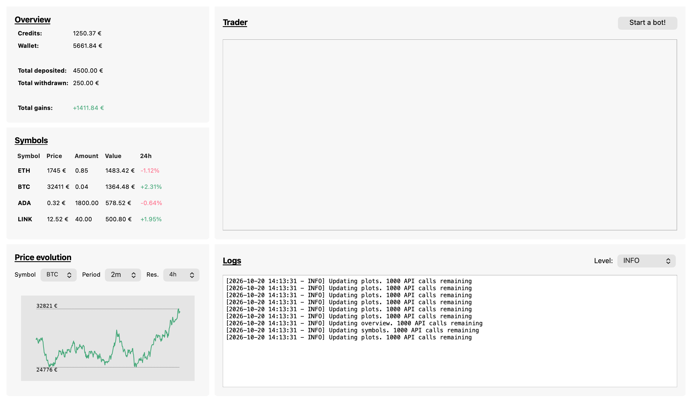
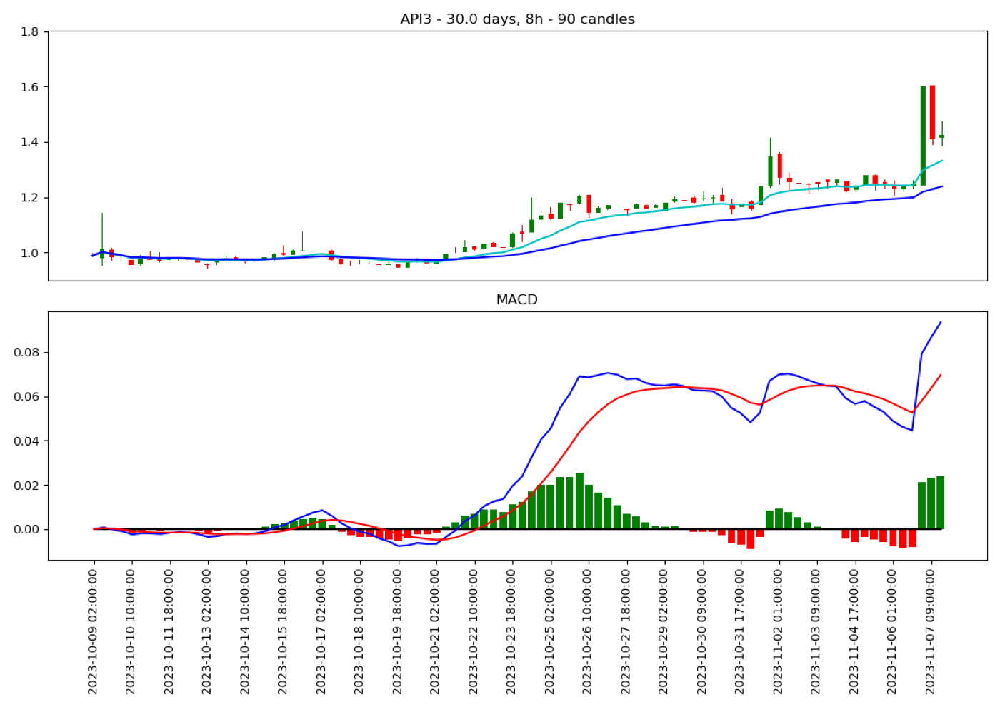
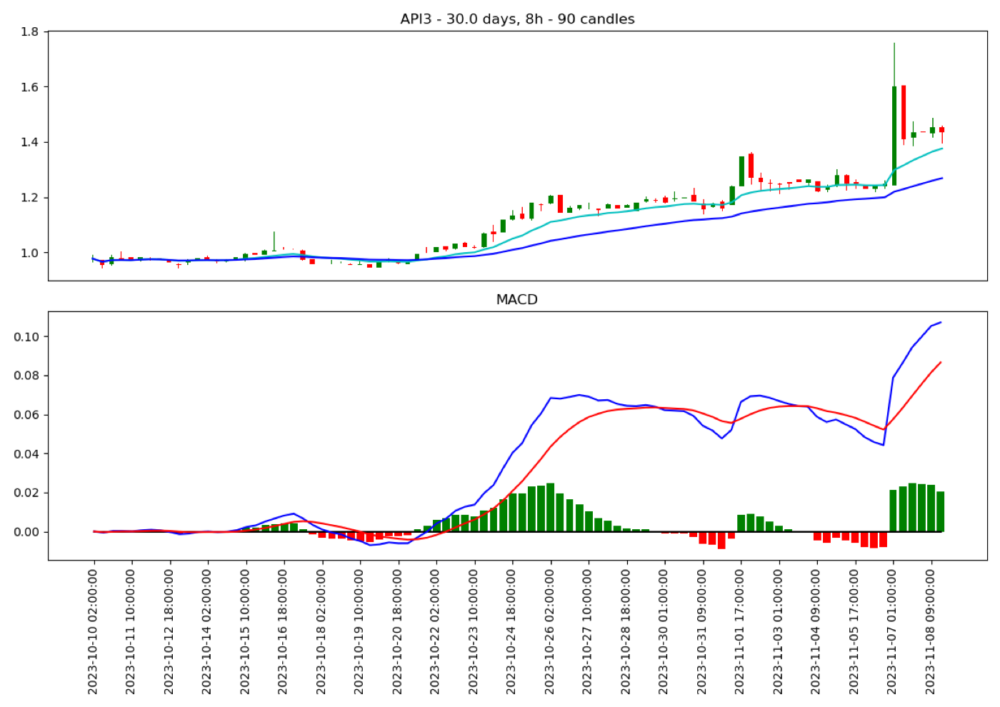

# Coinbot (desktop, PyQt5)

> **This is a toy project, and this branch is an old version of it.** The current version is the iOS app on [`main`](https://github.com/Jeremy009/Coinbot); this branch keeps the first attempt from 2023. Nothing here is financial advice, and you should not point it at an account you care about.

The first version of Coinbot: a Python desktop app, built with PyQt5 and Matplotlib, that watches a [Bitvavo](https://bitvavo.com) account and can start a simple MACD trading bot. It shows the wallet, the coins you hold and a price chart, and the bot buys and sells on its own based on MACD crossovers.



## What it does

- **Overview:** euro credits, the value of the wallet, the total deposited and withdrawn, and the resulting gain or loss.
- **Symbols:** every coin you hold with its price, amount, value and 24-hour change, sorted by value.
- **Price evolution:** a price chart for any coin on Bitvavo, with a selectable period (1 hour to 5 years) and candle resolution (1 minute to 1 day).
- **Logs:** the application log, with a selectable level. The window refreshes every 30 seconds in background threads.
- **Start a bot!:** starts `macd_stateless_trading_bot` (see below). It runs in the GUI thread, so the window freezes while the bot runs.

When the bot buys or sells, it saves a chart of the candles and the MACD it based the decision on. Two from November 2023:

| Buy signal | Sell signal |
|---|---|
|  |  |

## How it works

- `coinbot/__init__.py` sets up the Bitvavo connection (the API key goes here, see below), the colours and the time resolutions and spans.
- `coinbot/backend/clients.py`: `BitvavoClient` wraps the [python-bitvavo-api](https://github.com/bitvavo/python-bitvavo-api) package: balances, deposits, prices, candles (fetched in batches of 1000) and market orders, guarded by an API rate-limit decorator.
- `coinbot/backend/indicators.py` and `signals.py` compute the MACD and RSI and turn them into a buy, hold or sell signal. A buy needs a positive and rising MACD histogram.
- `coinbot/backend/macd_bot.py` is the bot. Every two hours it checks the open positions and sells those with a sell signal. Then it picks the coins that rose over the last 24 hours, traded a 24-hour volume above 250,000 and give a buy signal on 8-hour candles (MACD 12/39/9), and buys until it holds four positions. It is stateless: it reads its positions from the exchange on every run.
- `coinbot/frontend/` is a model-view-controller setup around the Qt Designer files in `coinbot/resources/ui/`.
- `scripts/analysis/` downloads 5 years of candles for a set of coins and backtests MACD parameters on them; [data/results.txt](data/results.txt) holds the results that picked 8h/12/39/9. `scripts/bitvavo/` contains small scripts written while getting to know the API.

## Running it

Requires Python 3.10 or later and a Bitvavo API key.

```sh
python3 -m venv .venv && source .venv/bin/activate
pip install -r requirements.txt
```

Put the API key and secret in `coinbot/__init__.py` (and never commit them), then start the app from the repository root:

```sh
python -m coinbot.main
```

The bot can also run without the window: `python -m coinbot.backend.macd_bot`. It trades with real money. The analysis scripts read and write candles in `data/`, which git ignores except for `results.txt`.

The screenshot uses fictional demo data; `python tools/screenshots/take_screenshot.py` regenerates it without an account.

## License

BSD 3-Clause, see [LICENSE](LICENSE).
