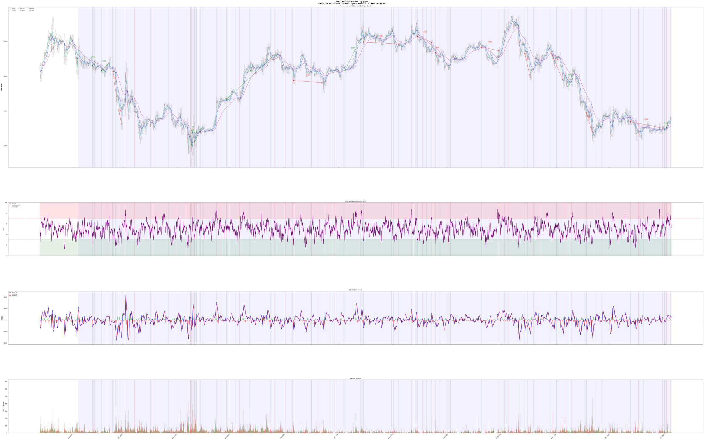
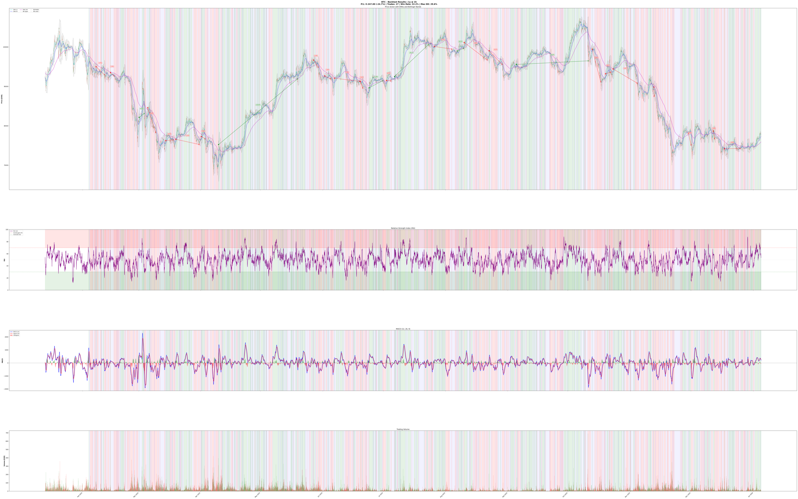
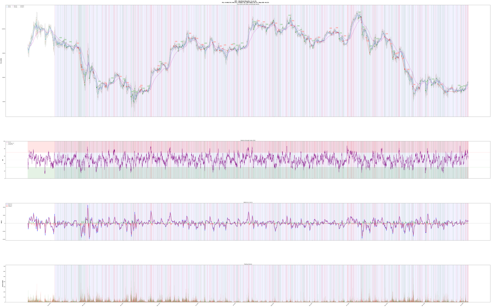

# Coinbot (headless, AWS Lambda)

> **This is a toy project, and this branch is an older version of it.** The current version is the iOS app on [`main`](https://github.com/Jeremy009/Coinbot); this branch keeps the headless rewrite from 2025–2026. Nothing here is financial advice, and all three backtests below lose money.

A headless, stateless cryptocurrency trading bot for [Bitvavo](https://bitvavo.com), written in Python 3.12. Every run it reads its open positions, scores every coin on the exchange with three technical-analysis strategies, buys the most convincing ones and sells positions whose stop-loss or exit signal triggers. It then saves its state and exits. It is packaged as a container for AWS Lambda, where EventBridge starts it every two hours, and it paper-trades by default.



*One year of BTC on 1-hour candles with the multi-strategy confluence, as plotted by the backtester: price with EMAs and Bollinger Bands, RSI, MACD and volume, with every buy and sell marked. Result: −12.3% over 19 trades.*

## What it does

- **Pre-filter:** skips coins it already holds, coins with less than €1M of 24-hour volume and coins that fell more than 10% in 24 hours.
- **Three strategies** on one month of 1-hour candles, each returning buy, hold or sell with a confidence:
  - **RSI + MACD:** oversold or overbought RSI confirmed by a MACD crossover.
  - **EMA crossover:** golden and death crosses of the 12 and 50 EMAs, filtered by the 200 EMA trend.
  - **Bollinger mean reversion:** bounces off the lower band and rejections at the upper band.
- **Confluence:** the strategies vote, and a buy needs at least 60% confidence. The bot holds at most 5 positions and uses at most 5% of the available funds.
- **Exits:** a trailing stop-loss sells a position that falls 8% below its highest price since purchase. Otherwise the strategies must agree on a sell with at least 65% confidence. The full decision tree is in [TRADING_LOGIC.md](TRADING_LOGIC.md).
- **Dry run:** with `BOT_DRY_RUN=true` (the default) orders are simulated against a virtual balance of €1,000 with Bitvavo's fees.
- **State and logs in S3:** positions, a trade log, the run log and a chart per decision are written to an S3 bucket, so every Lambda run starts where the last one stopped.
- **Backtesting:** replays the same strategies over years of historical candles and plots the result.

| EMA crossover only: −24.7% | MACD only: −40.1% |
|---|---|
|  |  |

## How it works

The code lives in `backend/src/coinbot_backend/`:

- `main.py`: `TradingBot` runs one iteration: load positions from S3, check exits, look for entries, save positions, upload logs and charts.
- `services/bitvavo_client.py`: the Bitvavo wrapper, with rate limiting, parallel requests and the dry-run order simulation.
- `services/trading_strategies.py`: the indicators (SMA, EMA, RSI, MACD, Bollinger Bands, ATR), the three strategies and the confluence vote.
- `services/s3_storage.py`: positions, trades and a logging handler that buffers log lines to S3.
- `services/technical_analysis_plot.py`: the chart saved with every decision.
- `backtesting/`: a backtest engine that steps through historical candles every two hours with the live strategies, plus the plots above.
- `config.py`: every setting, read from environment variables or `backend/.env` (see `.env.example`).
- `backend/lambda_handler.py` and the `Dockerfile` wrap a single iteration for AWS Lambda.

## Running it

Requires Python 3.12 and [uv](https://github.com/astral-sh/uv).

```sh
make install
cp .env.example backend/.env   # add BITVAVO_API_KEY and BITVAVO_API_SECRET
make run                       # one bot iteration (dry run unless BOT_DRY_RUN=false)
make test                      # the S3 tests need AWS credentials and the bucket set in S3_BUCKET_NAME
```

Backtest a coin (public market data, no API key needed for the candles):

```sh
cd backend
uv run python -m coinbot_backend.backtesting BTC --resolution 1h --span 1y --save btc.png
```

### Deploying to AWS Lambda

With the AWS CLI signed in, an ECR repository named `coinbot` and a Lambda function named `coinbot` (container image, arm64, 1024 MB, 15-minute timeout):

```sh
make lambda-publish   # builds the arm64 image, pushes it to ECR and updates the function
```

The account comes from `aws sts get-caller-identity`; override it with `AWS_ACCOUNT_ID=...`, and the region with `AWS_REGION=...` (default `eu-central-1`). Set the variables of `.env.example` (and `S3_BUCKET_NAME`) on the function, and add an EventBridge rule such as `rate(2 hours)` to start it on a schedule. The function's role needs read and write access to the bucket.

## License

BSD 3-Clause, see [LICENSE](LICENSE).
