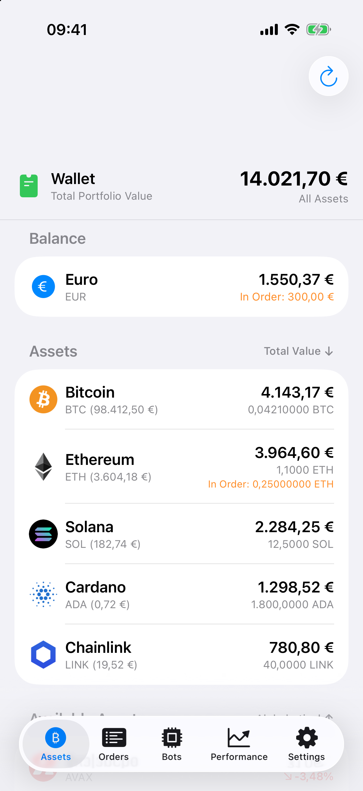
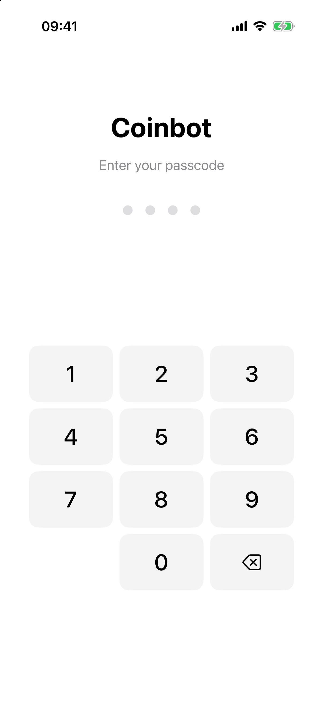
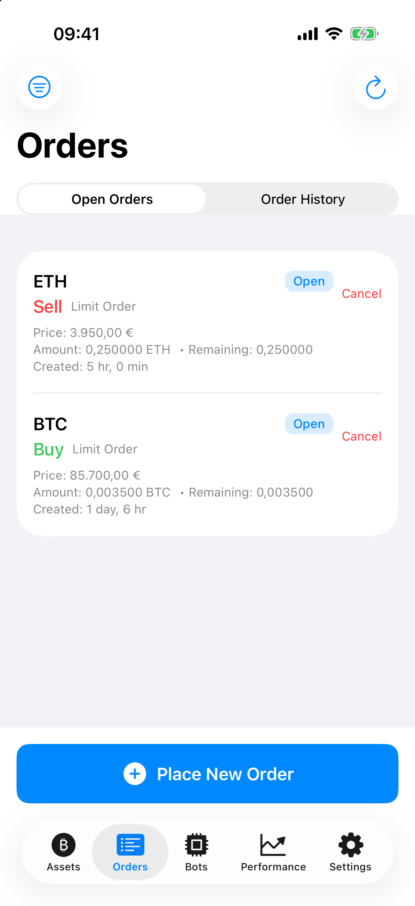
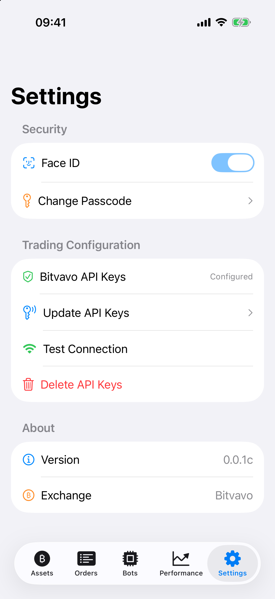
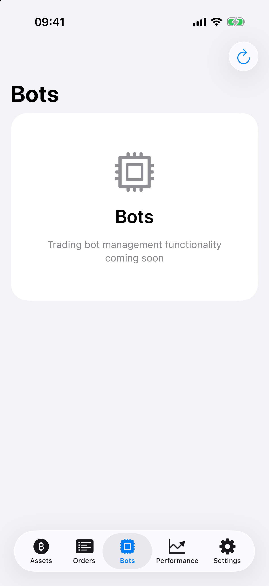

# Coinbot

> **This is a toy project.** Coinbot is a long-running pet project that is unlikely ever to be finished. It is not financial advice, it has never made money, and you should not point it at an account you care about.

An iPhone app, written in SwiftUI, for keeping an eye on a [Bitvavo](https://bitvavo.com) cryptocurrency account and placing trades from it. It is the latest of several attempts at the same idea: a bot that reads market data from an exchange API, runs technical indicators (and maybe one day a machine learning model) over it, and posts trades on its own. The app covers the "read the account and trade by hand" half; the "bot" half is still a placeholder tab. Earlier attempts in Python are kept on their own branches (see [Other versions](#other-versions)).

<p align="center"></p>

## What it does

- **Lock screen:** the app is protected by a 4-digit passcode and, optionally, Face ID. The passcode is hashed and kept in the iOS Keychain.
- **Assets:** the euro balance, every coin you hold with its value in euro, and the total value of the wallet. Below that is every coin listed on Bitvavo with its price and 24-hour change. Both lists can be sorted by name, price, change or value, and each coin shows its own icon (about 300 are bundled).
- **Orders:** open orders, which can be cancelled, and the order history with the fills of each order. **Place New Order** opens a form for market, limit, stop-loss and take-profit orders on any EUR market.
- **Settings:** the Bitvavo API key and secret (stored in the Keychain, never in the code), a connection test, Face ID and the passcode.
- **Bots and Performance:** placeholders for the trading bot and its results. Not implemented yet.

| Lock screen | Orders | Settings | Bots |
|---|---|---|---|
|  |  |  |  |

The screenshots use fictional demo data; `tools/screenshots/take-screenshots.sh` regenerates them.

## How it works

- `BitvavoAPIClient` talks to the Bitvavo REST API (v2) with `URLSession`. Private endpoints are signed with HMAC-SHA256 over `timestamp + method + /v2 + path + body`. [docs/BITVAVO_API.md](docs/BITVAVO_API.md) has notes on the API and on the authentication bug that took a while to find.
- `AuthenticationManager` owns the passcode, Face ID and API credentials, all stored with Keychain Services.
- `MainAppView` shows the passcode setup, the lock screen or the tab bar (`ContentView`), depending on the authentication state. Each tab is its own view: `AssetsView`, `OrdersView` (with `NewOrderView` and `OrderDetailView`), `BotsView`, `PerformanceView` and `SettingsView`.
- `Constants/` holds every URL, timeout, size, colour and keychain key, and `Localizable.strings` the user-facing text. Amounts are formatted with the user's locale, so Belgian and Dutch users see `1.234,56 €`.
- `Utilities/DemoMode.swift` serves fictional data in place of the Bitvavo API when the app is launched with `-demo`. That is how the screenshots are made.
- `tools/icons/` contains the Python scripts that downloaded the coin icons into `Assets.xcassets` and built `symbol-icon-mapping.json`.

## Other versions

The same idea has been started over a few times. Each version is kept on its own branch:

| Branch | What it is |
|---|---|
| `main` | This iOS app (2025) |
| [`desktop-qt`](https://github.com/Jeremy009/Coinbot/tree/desktop-qt) | The first version (2023): a PyQt5 desktop app with live candlestick charts and a MACD bot, plus the analysis scripts used to tune it |
| [`headless-lambda`](https://github.com/Jeremy009/Coinbot/tree/headless-lambda) | A headless rewrite (2025–2026): a stateless Python bot with several indicator strategies and a backtester, packaged to run on AWS Lambda every few hours |

## Running it

Requires Xcode 16 or later and iOS 17.6 or later.

```sh
open Coinbot.xcodeproj
```

Pick a simulator or your iPhone and press Run. On the first launch the app asks for a passcode. Then enter a Bitvavo API key and secret under **Settings**. A read-only key is enough to browse; placing orders needs a key with trading rights. To sign for a real device, set your own team under *Signing & Capabilities*.

To try the app without an account, add `-demo` under *Product › Scheme › Edit Scheme › Run › Arguments*. The demo passcode is `1234`.

The unit tests call the real API and read `BITVAVO_API_KEY` and `BITVAVO_API_SECRET` from a `.env` file in the repository root, which git ignores:

```sh
xcodebuild test -project Coinbot.xcodeproj -scheme Coinbot -destination 'platform=iOS Simulator,name=iPhone 17 Pro'
```

## License

BSD 3-Clause, see [LICENSE](LICENSE). The app icon is based on a Canva template, and the coin icons are logos of their respective projects; neither is covered by this license.
